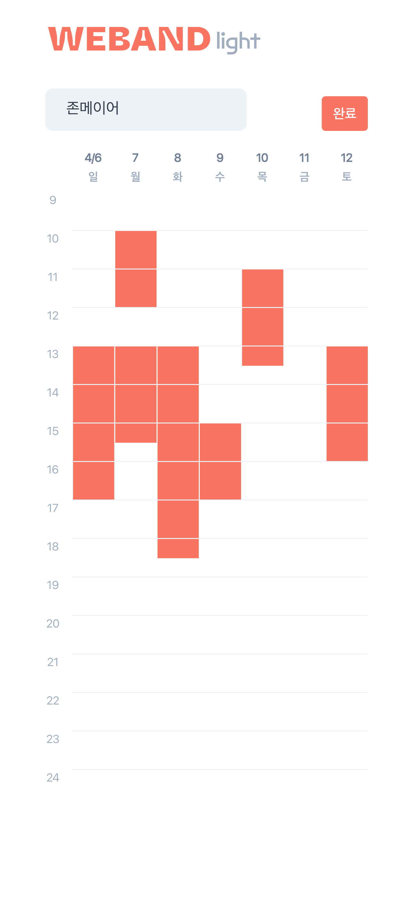
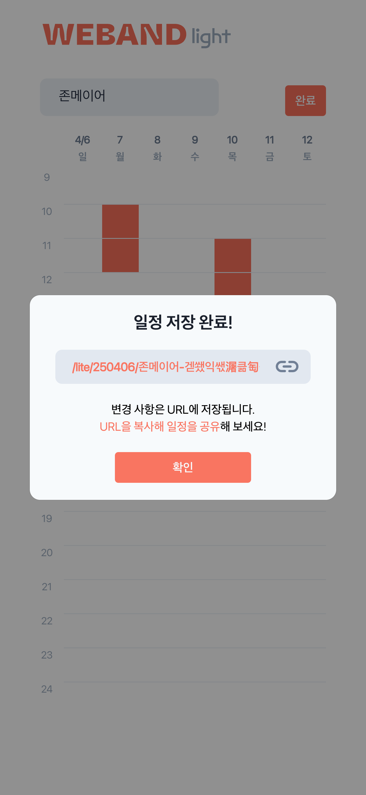
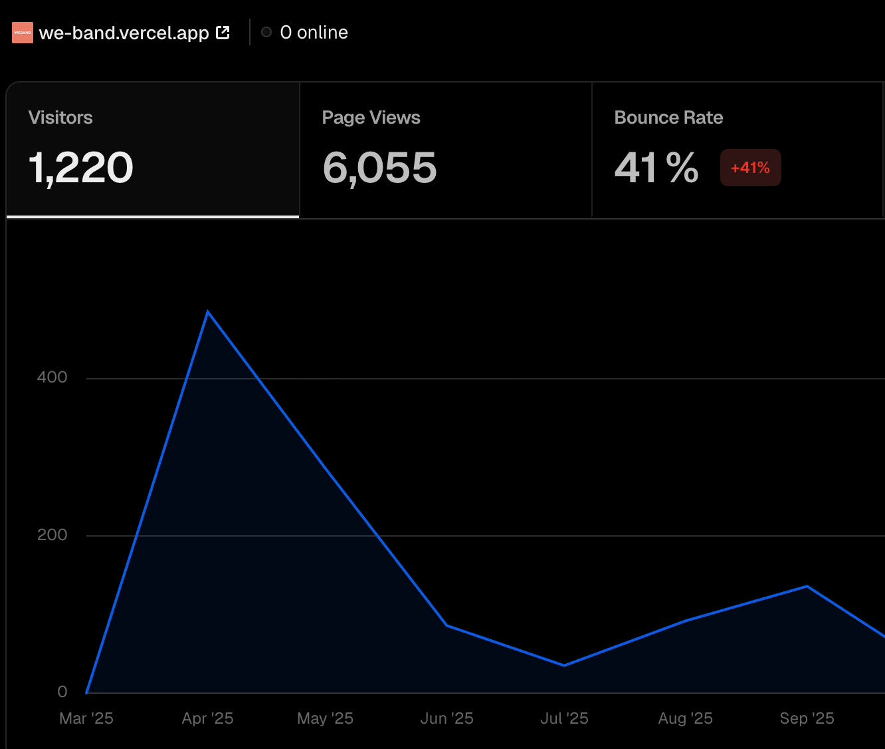

# WeBand (weband)

<p align="center">
  
  
  
</p>
팀원 간 일정을 쉽고 빠르게 조율할 수 있는 웹페이지입니다.  
기준 날짜를 선택해 일정 보드를 만들고, URL을 공유해 각 팀원이 가능한 시간을 입력하면 공통 가능 시간을 한눈에 확인할 수 있습니다.

## 프로젝트 개요

- 목적: 팀 단위 미팅/스터디/프로젝트 일정 조율
- 방식: Vercel Functions + Postgres에 팀 일정을 저장하고, 고정된 팀 링크로 공유
- 범위: 7일 단위 시간표 조율

## 핵심 기능

- 기준 날짜 선택 후 1주 일정 보드 생성
- 사용자별 가능 시간 입력/수정
- 팀 생성 시 랜덤 ID 발급, 링크 하나로 계속 공유 (일정을 추가해도 링크가 바뀌지 않음)
- 생성 후 2주가 지나면 자동 삭제
- 전체 보기/사용자별 보기 전환
- 시간대별 참여 가능 인원 수 시각화

## 데이터 저장 구조

- 경로: `/lite` (온보딩) → `/lite/{teamId}` (일정 보드)
- `teamId`는 `nanoid` 10자 랜덤 문자열입니다. 순차 ID가 아니라서 다른 팀 링크를 추측할 수 없습니다.
- 스키마: [`db/schema.sql`](./db/schema.sql)
  - `teams(id, start_date, created_at, expires_at)`
  - `members(team_id, name, schedule)`: `(team_id, name)` 기준 upsert라 여러 명이 동시에 입력해도 서로 덮어쓰지 않습니다.
  - `schedule`은 7일 × 30칸 = 210자 비트열입니다.
- 만료
  - `expires_at = max(생성 시각 + 14일, 보드 마지막 날 자정(KST))`
  - 조회/수정 API는 만료된 팀을 바로 404로 처리합니다.
  - Vercel Cron이 매일 03:00 KST에 `/api/cron/cleanup`을 호출해 만료된 팀을 삭제합니다. (`members`는 cascade 삭제)
- 팀당 최대 30명

### API

| Method | Path | 설명 |
| --- | --- | --- |
| `POST` | `/api/teams` | `{ startDate: 'YYYY-MM-DD' }`로 팀 생성 |
| `GET` | `/api/teams/:id` | 팀 정보 + 멤버 일정 조회 |
| `PUT` | `/api/teams/:id/members/:name` | `{ schedule }`로 멤버 일정 저장 (upsert) |
| `DELETE` | `/api/teams/:id/members/:name` | 멤버 삭제 |
| `GET` | `/api/cron/cleanup` | 만료 팀 삭제 (Vercel Cron 전용) |

## (v1) URL 인코딩 최적화 로직

> DB 도입 전, 일정 전체를 URL에 담던 시절의 로직입니다.

- 일정 상태를 고정 길이 비트열(`SCHEDULE_BIT_LENGTH`)로 표현합니다. (현재 Lite 기준 `210bit`)
- 인코딩은 하이브리드 방식입니다.
- 방식 A(비트셋): 비트열을 `BigInt`로 변환한 뒤 URL-safe 문자셋 `A-Z a-z 0-9 - _`로 인코딩합니다.
- 방식 B(구간 압축): `1`이 연속된 구간을 `(start, length)` 쌍으로 압축해 저장합니다.
- 두 방식 결과를 모두 만든 뒤, 더 짧은 문자열을 자동으로 선택합니다.
- 스케줄이 전부 `0`인 경우는 `"0"` 1글자로 저장합니다.
- 사용자별 URL 세그먼트는 `{name}.{encodedSchedule}` 형태로 구성합니다.
- 디코딩 시 인코딩 문자열을 다시 비트열로 복원하고, `padStart/slice`로 고정 길이 정규화를 수행합니다.
- 성과 1: 비트셋 상한은 최대 `35 bytes`이지만, 연속 구간이 많은 일정은 더 짧아집니다.
- 성과 2: 예시(두 구간 일정) `bitset 30자 -> 구간압축 9자`까지 단축됩니다.
- 성과 3: URL-safe 문자만 사용해 퍼센트 인코딩 오버헤드를 줄이고, 복사/공유 시 안정적으로 유지됩니다.

## 실 사용자

<p align="center">
  
</p>
출시 후 1달 안에 약 600명의 사용자 유입이 있었습니다.

## 한계점

초반에는 쉬운 사용성 덕분에 빠르게 사용자 유입이 이루어졌지만,
일정을 추가할 때마다 URL이 변경되어 매번 새 링크를 다시 공유해야 하는 불편함이 있었습니다.

→ Postgres를 붙여 팀마다 고정 링크를 발급하는 방식으로 개선했습니다.

## 기술 스택

- Language: TypeScript
- Framework: React 19
- Build Tool: Vite 6
- Styling: styled-components, SCSS
- Routing: react-router-dom
- State: zustand
- Backend: Vercel Functions, Postgres (Neon), postgres.js
- Package Manager: Yarn 4

## 시작하기

```bash
yarn install
cp .env.example .env.local   # DATABASE_URL 채우기
psql "$DATABASE_URL" -f db/schema.sql   # 최초 1회
vercel dev                   # 프론트 + /api 함수 함께 실행
```

- `yarn dev`는 Vite만 띄우기 때문에 `/api`가 동작하지 않습니다. API까지 확인하려면 `vercel dev`를 사용하세요.

### 배포 설정 (Vercel)

1. Vercel 프로젝트 → Storage(Marketplace)에서 Neon Postgres를 연결하면 `DATABASE_URL`이 자동으로 들어갑니다.
2. Neon SQL Editor에서 `db/schema.sql`을 한 번 실행합니다.
3. 환경변수 `CRON_SECRET`에 임의의 긴 문자열을 넣습니다. (cleanup 엔드포인트 보호용)

## 스크립트

- `yarn dev`: 개발 서버 실행
- `yarn build`: 프로덕션 빌드
- `yarn preview`: 빌드 결과 로컬 미리보기
- `yarn lint`: ESLint 검사

## Branch Naming Rule

```text
<type>/<issue-number>-<short-description>

feat/1234-add-user-login
fix/5678-fix-login-error
release/1.2.0
```

- `feat/`: 새로운 기능 개발
- `fix/`: 버그 수정
- `hotfix/`: 긴급 버그 수정
- `release/`: 릴리즈 준비
- `chore/`: 문서/설정/빌드 등 비기능 작업

## Git Commit 규칙

- `feat`: 새로운 기능 추가
- `fix`: 버그 수정
- `refactor`: 리팩토링
- `style`: 포맷/스타일 수정
- `test`: 테스트 추가/수정
- `docs`: 문서 작업
- `chore`: 빌드/설정/의존성 작업

## 프로젝트 구조

```text
api/                # Vercel Functions (팀/멤버 API, 만료 정리 cron)
db/
└── schema.sql      # Postgres 스키마
src/
├── api/            # API 클라이언트
├── assets/         # 이미지, 아이콘 등 정적 리소스
├── components/     # 캘린더/온보딩/헤더 등 UI 컴포넌트
├── constants/      # 시간, 알림 등 상수
├── icons/          # SVG 아이콘 컴포넌트
├── layout/         # 메인/라이트 레이아웃
├── pages/          # 라우트 페이지
├── store/          # Zustand 스토어
├── styles/         # 전역 스타일 및 테마
├── types/          # 타입 정의
├── utils/          # 일정/날짜 유틸리티
├── App.tsx
└── main.tsx
```
